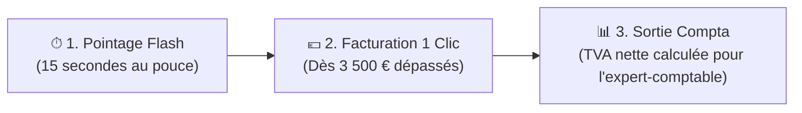

# Fiche Réflexe VP Expertise — Guide de Prise en Main Rapide
> **Pour Valentine** • Conçu pour alléger votre quotidien, facturer à temps et supprimer la double saisie.

---

## 💡 Le principe : 3 gestes, 0 double saisie

Vous n'avez pas besoin d'apprendre un logiciel complexe. L'application est organisée autour de vos 3 vrais besoins :

---

## Geste n°1 : En fin de réunion ou sur site (15 secondes sur smartphone)

Quand vous terminez une réunion contradictoire, une visio ou une visite sur les voies :

1. Ouvrez l'application sur votre téléphone et appuyez sur le bouton rond **`+ Flash`** en bas de l'écran.
2. **Pour le temps** :
   * Choisissez le dossier dans la liste (ex: *ALSTOM Ligne 18*).
   * Appuyez sur une pastille de durée : **`[ 1h ]`**, **`[ 2h ]`** ou **`[ 3,5h ]`**.
   * Appuyez sur une pastille d'objet (ex: `+ Réunion contradictoire`) ou tapez votre libellé.
   * Validez : votre temps est sécurisé au bon tarif horaire (190 € ou 135 € trajet).
3. **Pour la feuille de présence (émargement)** :
   * Basculez sur l'onglet **« Photo terrain »**.
   * Appuyez sur **« Prendre une photo »** : l'appareil photo de votre smartphone s'ouvre directement.
   * Photographiez la feuille d'émargement manuscrite : elle est enregistrée dans le dossier et prête pour le rapport Word.

---

## Geste n°2 : Facturer dès qu'un dossier dépasse 3 500 € (60 secondes)

Vous n'avez plus besoin d'ouvrir Excel, de refaire les calculs puis de copier-coller dans Word :

1. Sur votre écran d'accueil (**Cockpit**), regardez la carte **« À facturer »** ou vos alertes.
2. Dès qu'un dossier dépasse votre seuil (ex: *REGIORAIL : 4 123,50 € HT*), une alerte orange apparaît.
3. Cliquez sur **`Facturer`** :
   * Toutes vos heures et vos frais non facturés sont déjà cochés.
   * Le montant HT, la TVA 20% et le TTC sont calculés au centime exact.
   * Le numéro de facture officiel suivant (ex: `2026-100`) est attribué automatiquement.
4. Cliquez sur **`Émettre`** puis sur **`DOCX`** :
   * Votre document Word officiel VP Expertise est téléchargé instantanément.
   * Les heures facturées sont verrouillées (impossible de les refacturer par erreur).

---

## Geste n°3 : En fin de mois, transmettre à votre expert-comptable (30 secondes)

Pour votre déclaration de TVA mensuelle sans y passer votre week-end :

1. Cliquez sur l'onglet **`Comptabilité`**.
2. Sélectionnez le mois (ex: *Octobre 2026*) :
   * Vous visualisez en direct vos **Recettes TTC**, vos **Dépenses TTC**, et la **TVA nette exacte à reverser à l'État**.
   * Chaque facture émise dans le mois a été automatiquement inscrite en recette.
3. Cliquez sur le bouton bleu **`Exporter Excel (.xlsx)`** :
   * Le fichier tableur conforme au modèle de votre cabinet comptable est généré.
   * Vous n'avez plus qu'à le transférer par email à votre expert-comptable.

---

## 🤖 NOUVEAU : Votre Assistant IA Exécutif (Gemini 2.5 Flash)

Vous avez désormais un **assistant IA directement intégré** (bouton **`✨ Assistant IA`** en haut à droite, ou la bulle ronde flottante en bas à droite) :

* **Toujours branché sur vos dossiers réels** : il connaît vos dossiers en cours, vos heures non facturées, vos dates de Dires et vos chiffres de TVA.
* **Génération de mails et relances en 1 clic** : demandez-lui par exemple *« Rédige un mail courtois pour relancer l'avocat sur son Dire n°2 »* puis appuyez sur **`Copier`** pour le coller directement dans Outlook ou Mail.
* **Économique et instantané** : propulsé par **Gemini 2.5 Flash** (modèle léger, ultra rapide et peu gourmand).
* **Mode local sécurisé garanti** : même sans connexion internet ou clé API configurée, l'assistant répond immédiatement à partir des données de votre cabinet.

---

## 📱 Astuce Terrain : Installer l'application sur l'écran d'accueil de votre iPhone

Pour l'ouvrir d'un simple toucher comme une vraie application mobile, sans taper d'adresse web :

1. Ouvrez le lien de l'application dans **Safari** sur votre iPhone.
2. Appuyez sur le bouton **Partager** (le carré avec une flèche vers le haut, au milieu en bas de Safari).
3. Faites défiler vers le bas et appuyez sur **« Sur l'écran d'accueil »** (avec l'icône `+`).
4. Nommez-le **« VP Expertise »** et appuyez sur **Ajouter**.
5. L'icône VP Expertise apparaît sur l'écran de votre téléphone : un tap dessus l'ouvre en plein écran, prête pour vos pointages et vos photos !

---

> [!NOTE] 
> **Ce que l'application ne fait pas (et c'est volontaire)** :
> * Elle ne lit pas votre boîte email personnelle pour ne pas aspirer de données confidentielles. Vous glissez simplement les dires et convocations importants dans le dossier.
> * Elle n'achète pas vos billets de train ni vos nuits d'hôtel. Vous notez simplement vos km ou votre ticket pour vous faire rembourser.
> * L'analyse technique ferroviaire reste votre métier : l'application s'occupe de la logistique administrative pour vous laisser l'esprit libre.
