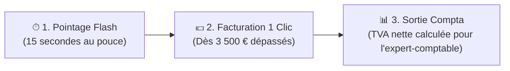
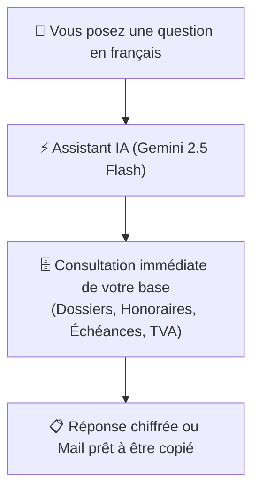

# Fiche Réflexe VP Expertise — Guide de Prise en Main Rapide
> **Pour Valentine** • Conçu pour alléger votre quotidien, facturer à temps et supprimer la double saisie.

---

## 💡 Le principe : 3 gestes, 0 double saisie

Vous n'avez pas besoin d'apprendre un logiciel complexe. L'application est organisée autour de vos 3 vrais besoins :

---

## Geste n°1 : En fin de réunion ou sur site (15 secondes sur smartphone)

Quand vous terminez une réunion contradictoire, une visio ou une visite sur les voies :

1. Ouvrez l'application sur votre téléphone et appuyez sur le bouton rond **`+ Flash`** en bas de l'écran.
2. **Pour le temps** :
   * Choisissez le dossier dans la liste (ex: *ALSTOM Ligne 18*).
   * Appuyez sur une pastille de durée : **`[ 1h ]`**, **`[ 2h ]`** ou **`[ 3,5h ]`**.
   * Appuyez sur une pastille d'objet (ex: `+ Réunion contradictoire`) ou tapez votre libellé.
   * Validez : votre temps est sécurisé au bon tarif horaire (190 € ou 135 € trajet).
3. **Pour la feuille de présence (émargement)** :
   * Basculez sur l'onglet **« Photo terrain »**.
   * Appuyez sur **« Prendre une photo »** : l'appareil photo de votre smartphone s'ouvre directement.
   * Photographiez la feuille d'émargement manuscrite : elle est enregistrée dans le dossier et prête pour le rapport Word.

---

## Geste n°2 : Facturer dès qu'un dossier dépasse 3 500 € (60 secondes)

Vous n'avez plus besoin d'ouvrir Excel, de refaire les calculs puis de copier-coller dans Word :

1. Sur votre écran d'accueil (**Cockpit**), regardez la carte **« À facturer »** ou vos alertes.
2. Dès qu'un dossier dépasse votre seuil (ex: *REGIORAIL : 4 123,50 € HT*), une alerte orange apparaît.
3. Cliquez sur **`Facturer`** :
   * Toutes vos heures et vos frais non facturés sont déjà cochés.
   * Le montant HT, la TVA 20% et le TTC sont calculés au centime exact.
   * Le numéro de facture officiel suivant (ex: `2026-100`) est attribué automatiquement.
4. Cliquez sur **`Émettre`** puis sur **`DOCX`** :
   * Votre document Word officiel VP Expertise est téléchargé instantanément.
   * Les heures facturées sont verrouillées (impossible de les refacturer par erreur).

---

## Geste n°3 : En fin de mois, transmettre à votre expert-comptable (30 secondes)

Pour votre déclaration de TVA mensuelle sans y passer votre week-end :

1. Cliquez sur l'onglet **`Comptabilité`**.
2. Sélectionnez le mois (ex: *Octobre 2026*) :
   * Vous visualisez en direct vos **Recettes TTC**, vos **Dépenses TTC**, et la **TVA nette exacte à reverser à l'État**.
   * Chaque facture émise dans le mois a été automatiquement inscrite en recette.
3. Cliquez sur le bouton bleu **`Exporter Excel (.xlsx)`** :
   * Le fichier tableur conforme au modèle de votre cabinet comptable est généré.
   * Vous n'avez plus qu'à le transférer par email à votre expert-comptable.

---

## 🤖 Votre Assistant IA Exécutif (Gemini 2.5 Flash) — Mode d'Emploi

L'assistant IA est votre secrétaire et bras droit numérique disponible 24h/24. Il est propulsé par le modèle **Gemini 2.5 Flash** (ultra-rapide, économique et léger) et **directement branché sur vos données réelles**. Il ne bavarde pas et ne théorise pas : il vous donne des réponses concrètes et rédige vos courriers à votre place.

---

### 1. Comment l'ouvrir et le fermer ?
* **Sur ordinateur ou tablette** : cliquez sur le bouton bleu ciel **`✨ Assistant IA`** dans la barre du haut, ou sur la bulle noire et bleue flottante en bas à droite de votre écran.
* **Sur smartphone (iPhone / Android)** : appuyez sur le bouton **`✨ IA`** en haut à droite (ou sur la bulle en bas).
* **Pour le fermer** : appuyez sur la croix **`✕`** en haut à droite ou cliquez à l'extérieur du panneau.

---

### 2. Comment lui parler ?
Parlez-lui normalement, comme à un confrère ou une assistante de direction. Pas besoin de formule magique ni de vocabulaire technique d'informaticien.

Vous pouvez soit :
* **Taper directement votre question** dans le champ de texte en bas et appuyer sur Entrée (ou sur l'icône d'envoi).
* **Cliquer sur une suggestion rapide** sous le chat pour obtenir une réponse en un clic :
  * `⚠️ Seuils > 3 500 €`
  * `📅 Prochaines échéances`
  * `📊 Bilan TVA & CA`
  * `✉️ Rédiger une relance Dire`

---

### 3. Les 4 grands cas d'usage au quotidien (Exemples concrets)

#### Cas A : Rédiger un email officiel ou une relance en 5 secondes
Vous devez relancer un avocat ou un expert contradicteur, mais vous n'avez ni le temps ni l'énergie de rédiger les formules de politesse ? Demandez-lui :
> 🗣 *« Rédige un mail courtois mais ferme pour relancer l'avocat de VINCI sur le dépôt de son Dire n°2. »*
> 🗣 *« Prépare-moi un message pour avertir l'assureur ALBINGIA que le seuil de 3 500 € d'honoraires est atteint sur le dossier Regiorail. »*

👉 **Le réflexe à avoir** : Dès que l'assistant affiche le projet de message, cliquez sur le bouton **`Copier`** situé juste en dessous. Vous n'avez plus qu'à faire **Coller (`Cmd + V` ou `Ctrl + V`)** directement dans Outlook, Apple Mail ou Thunderbird !

#### Cas B : Prendre la météo d'un dossier avant un coup de fil ou une réunion
Vous devez appeler un client ou un avocat et vous voulez vous rafraîchir la mémoire immédiatement :
> 🗣 *« Fais-moi le point sur le dossier Alstom Ligne 18 : qui sont les parties et où en est-on ? »*
> 🗣 *« Combien d'heures et de frais ai-je engagés sur le déraillement de Clermont-Gravanche ? »*

L'assistant consulte instantanément la base et vous résume les références, le montant non facturé, les dernières activités pointées et la date du prochain jalon.

#### Cas C : Piloter sa facturation et ne jamais oublier de facturer
> 🗣 *« Quels sont les dossiers où j'ai dépassé le seuil d'alerte de 3 500 € ? »*
> 🗣 *« Quel est le montant total de mes honoraires en attente de facturation ? »*

L'assistant vous liste le ou les dossiers concernés (ex: *VP2026104 - Regiorail avec 4 123,50 € HT en attente*) et vous invite à vous rendre sur l'onglet **Honoraires** pour émettre la note en un clic.

#### Cas D : Connaître sa situation comptable et sa TVA
> 🗣 *« Quel est mon chiffre d'affaires émis ce mois-ci et combien de TVA dois-je payer ? »*
> 🗣 *« Quelles sont les dernières factures que j'ai émises ? »*

---

### 4. L'astuce pratique : Le « Contexte Ciblé »
Quand vous êtes déjà en train de consulter un dossier précis dans l'onglet **Dossiers** (par exemple la fiche de la mission *ALSTOM Ligne 18*), l'assistant affiche un badge bleu : **`Contexte actif : [VP2026922]`**.

Vous n'avez même plus besoin de préciser le nom du dossier dans vos questions ! Demandez-lui simplement :
* *« Qui sont les personnes convoquées sur ce dossier ? »*
* *« Rédige une note de synthèse des 3 dernières opérations réalisées ici. »*
* *« Quel est le taux horaire appliqué sur cette mission ? »*

---

### 5. Boutons et raccourcis utiles dans le panneau de l'assistant
* **Bouton `Copier`** : copie la réponse complète dans votre presse-papier sans sélectionner le texte à la souris.
* **Bouton `🔄` (en haut à droite)** : réinitialise la discussion pour repartir d'une page blanche.
* **Badge de statut** :
  * `Gemini 2.5 Flash` : génération intelligente complète connectée à Google AI Studio.
  * `Local Conforme` : fonctionne en toute sécurité même si votre connexion est coupée ou si aucune clé n'est configurée, en puisant directement dans les données de votre cabinet.

---

## 📱 Astuce Terrain : Installer l'application sur l'écran d'accueil de votre iPhone

Pour l'ouvrir d'un simple toucher comme une vraie application mobile, sans taper d'adresse web :

1. Ouvrez le lien de l'application dans **Safari** sur votre iPhone.
2. Appuyez sur le bouton **Partager** (le carré avec une flèche vers le haut, au milieu en bas de Safari).
3. Faites défiler vers le bas et appuyez sur **« Sur l'écran d'accueil »** (avec l'icône `+`).
4. Nommez-le **« VP Expertise »** et appuyez sur **Ajouter**.
5. L'icône VP Expertise apparaît sur l'écran de votre téléphone : un tap dessus l'ouvre en plein écran, prête pour vos pointages et vos photos !

---

> [!NOTE] 
> **Ce que l'application ne fait pas (et c'est volontaire)** :
> * Elle ne lit pas votre boîte email personnelle pour ne pas aspirer de données confidentielles. Vous glissez simplement les dires et convocations importants dans le dossier.
> * Elle n'achète pas vos billets de train ni vos nuits d'hôtel. Vous notez simplement vos km ou votre ticket pour vous faire rembourser.
> * L'analyse technique ferroviaire reste votre métier : l'application s'occupe de la logistique administrative pour vous laisser l'esprit libre.
